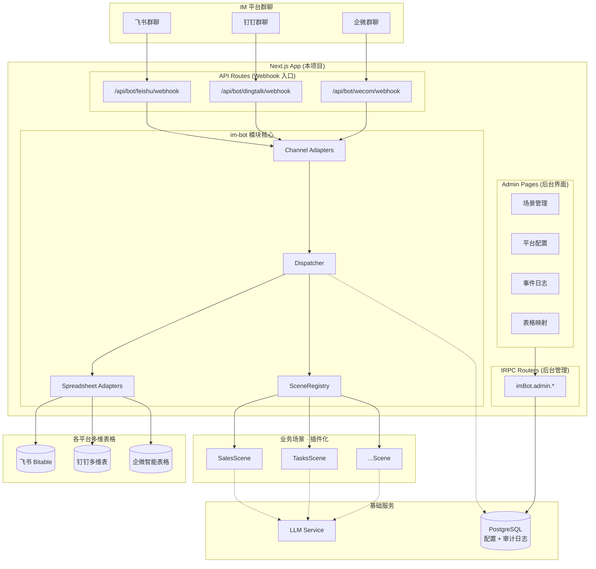
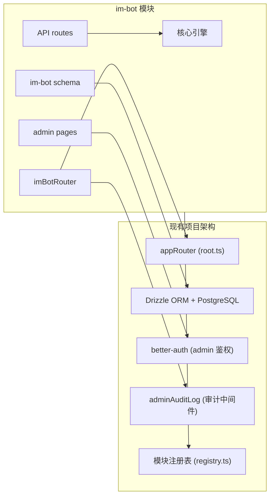
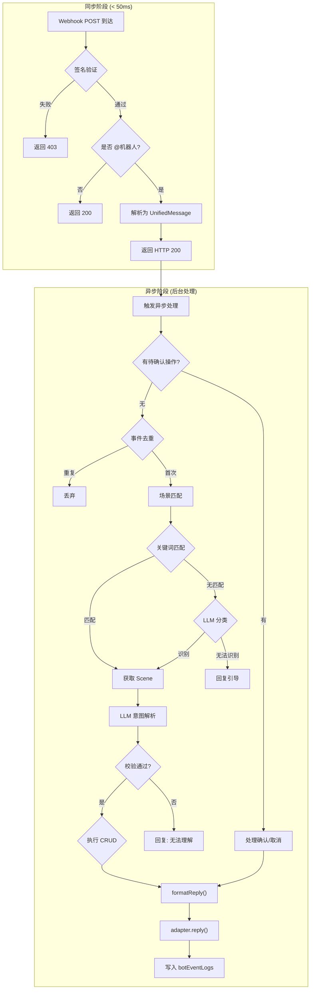
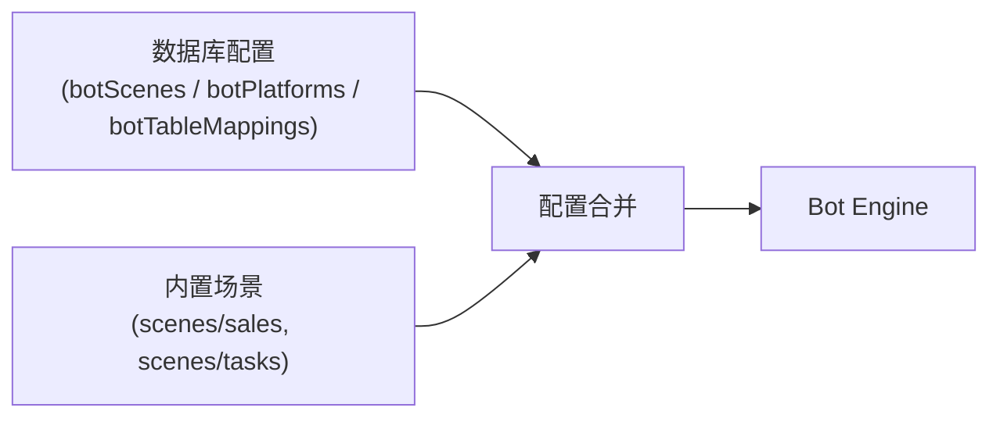

# IM Bot 模块架构设计

> **状态**: Approved
> **日期**: 2026-04-03
> **位置**: `src/modules/im-bot/`
>
> ### 实施决策 (2026-04-03)
> | 决策项 | 选择 |
> |--------|------|
> | LLM 接入 | OpenAI 兼容 SDK (`openai` 包 + baseURL) |
> | 内置场景 | Sales + Tasks 两个 |
> | 凭证存储 | 环境变量优先，数据库作为备选展示 |
> | CRUD 范围 | 一步到位，完整 CRUD + PendingAction |
> | 后台范围 | 全部四个页面（场景、平台配置、表格映射、事件日志） |
> | 多平台 | 飞书先实现，钉钉/企微预留 TODO |

## 概述

基于飞书/钉钉/企微群聊的 LLM 机器人模块，作为当前项目的业务模块（与 lucky-wheel、soulscope 同级），对外提供 Webhook 回调 API，并提供后台管理界面用于配置参数、管理场景。

用户在 IM 群聊中 @机器人发送自然语言消息，系统通过 LLM 自动解析意图、提取结构化字段，写入各平台多维表格，并在群聊中返回执行结果。支持增删改查全操作，场景可插件化扩展。

## 动机

团队日常有大量结构化数据需要录入多维表格（销售记录、任务跟踪、报销审批等），目前依赖手工操作：

- **操作繁琐**：打开多维表格 → 找到正确的表 → 逐字段填写，一条记录耗时 1~3 分钟
- **场景分散**：不同业务使用不同平台（飞书/钉钉/企微），每个平台的表格 API 差异大
- **数据不及时**：离开群聊去填表的摩擦导致数据延迟录入甚至遗漏

通过 @机器人发送自然语言消息，零切换成本、LLM 自动提取结构化数据、平台自动路由、场景插件化扩展。

## 目标与非目标

### 目标

| 优先级 | 目标 | 说明 |
|--------|------|------|
| P0 | 飞书端到端打通 | 飞书群聊 @机器人 → LLM 解析 → 写入 Bitable → 回复结果 |
| P0 | 场景插件化架构 | BotScene 接口契约，新增场景不触碰已有代码 |
| P0 | 多维表格 CRUD | 支持新增/查询/编辑/删除四种操作 |
| P0 | 后台管理界面 | 场景配置、平台凭证管理、表格映射、事件日志查看 |
| P1 | 多平台消息通道 | 飞书/钉钉/企微三平台消息接入与回复 |
| P1 | 多平台表格适配 | Bitable / 宜搭多维表 / 智能表格 统一 CRUD 接口 |
| P1 | 事件去重与审计 | eventId 幂等 + 数据库审计日志 |

### 非目标

- 不做通用聊天机器人（只处理 @机器人 的结构化业务消息）
- 不做多轮对话管理（单消息单意图）
- 不做文件/图片/语音消息处理（仅处理文本消息）
- 不替代多维表格本身的管理界面（只提供群聊快捷通道）

## 系统架构

### 架构图



### 与项目架构的集成关系



**集成要点**：
- im-bot 作为 `src/modules/im-bot/` 下的标准业务模块，注册到 `registry.ts`
- Webhook API 通过 Next.js App Router 的 `src/app/api/bot/` 路由对外暴露
- 后台管理通过 tRPC adminProcedure，复用现有的 admin 鉴权 + 审计日志中间件
- 数据库 schema 使用项目的 `createTable` helper（带 `pg-drizzle_` 前缀）
- 管理页面在 `src/app/admin/im-bot/` 下，使用 Ant Design 组件

### 分层架构

| 层级 | 职责 | 对应代码位置 |
|------|------|-------------|
| **协议层** | Webhook 入口，HTTP 收发 | `src/app/api/bot/[platform]/webhook/route.ts` |
| **入方向适配** | Channel Adapter — 平台消息 → UnifiedMessage | `src/modules/im-bot/channels/` |
| **业务层** | 去重、场景路由、流程编排 | `src/modules/im-bot/core/` |
| **场景层** | 具体业务逻辑（prompt / 校验 / 格式化） | `src/modules/im-bot/scenes/` |
| **出方向适配** | Spreadsheet Adapter — 统一 CRUD → 平台表格 API | `src/modules/im-bot/spreadsheets/` |
| **数据层** | 配置、审计日志持久化（Drizzle + PostgreSQL） | `src/modules/im-bot/schema/` |
| **管理层** | tRPC Router + Admin Pages | `src/modules/im-bot/routers/` + `admin/` |

## 目录结构

```
src/modules/im-bot/
├── index.ts                           # 模块入口，导出 router + 引擎创建函数
├── constants.ts                       # 模块常量、枚举、标签映射
│
├── schema/                            # 数据库 schema (Drizzle)
│   ├── index.ts                       # 汇总导出所有 schema
│   ├── bot-scenes.ts                  # 场景配置表
│   ├── bot-platforms.ts               # 平台凭证配置表
│   ├── bot-table-mappings.ts          # 表格映射配置表
│   └── bot-event-logs.ts             # 事件审计日志表
│
├── routers/                           # tRPC Routers
│   ├── index.ts                       # imBotRouter 汇总
│   ├── admin.ts                       # 后台管理 CRUD (adminProcedure)
│   └── stats.ts                       # 统计概览 (adminProcedure)
│
├── admin/                             # Admin UI 组件
│   ├── scenes.tsx                     # 场景管理页
│   ├── platforms.tsx                  # 平台配置页
│   ├── table-mappings.tsx             # 表格映射页
│   └── event-logs.tsx                 # 事件日志页
│
├── core/                              # 核心引擎
│   ├── dispatcher.ts                  # 消息调度中枢
│   ├── scene-registry.ts             # 场景注册中心
│   ├── dedup.ts                       # 事件去重
│   ├── pending-action.ts             # 有状态交互 (二次确认)
│   └── llm.ts                         # LLM 调用封装
│
├── channels/                          # 消息通道适配器
│   ├── types.ts                       # ChannelAdapter 接口
│   ├── feishu.ts                      # 飞书消息适配
│   ├── dingtalk.ts                    # 钉钉消息适配
│   └── wecom.ts                       # 企微消息适配
│
├── spreadsheets/                      # 多维表格适配器
│   ├── types.ts                       # SpreadsheetAdapter 接口
│   ├── feishu-bitable.ts             # 飞书 Bitable
│   ├── dingtalk-sheet.ts             # 钉钉宜搭多维表
│   ├── wecom-sheet.ts                # 企微智能表格
│   └── factory.ts                     # 根据 platform 返回对应 adapter
│
├── scenes/                            # 内置业务场景
│   ├── types.ts                       # BotScene 接口定义
│   ├── sales/                         # 销售记录场景
│   │   ├── index.ts
│   │   ├── prompt.ts
│   │   └── formatter.ts
│   └── tasks/                         # 任务跟踪场景
│       ├── index.ts
│       ├── prompt.ts
│       └── formatter.ts
│
├── auth/                              # 各平台 Token 管理
│   ├── types.ts                       # TokenManager 接口
│   ├── feishu-token.ts
│   ├── dingtalk-token.ts
│   └── wecom-token.ts
│
└── services/                          # 业务服务
    ├── bot-engine.ts                  # Bot 引擎创建与初始化
    └── config-loader.ts              # 从数据库加载运行时配置

src/app/
├── api/bot/                           # Webhook API Routes
│   └── [platform]/
│       └── webhook/
│           └── route.ts              # POST handler
│
└── admin/im-bot/                      # Admin Pages
    ├── page.tsx                       # 场景管理 (默认页)
    ├── platforms/
    │   └── page.tsx                   # 平台配置
    ├── table-mappings/
    │   └── page.tsx                   # 表格映射
    └── event-logs/
        └── page.tsx                   # 事件日志
```

## 详细设计

### 数据库 Schema

#### 场景配置表

```typescript
// src/modules/im-bot/schema/bot-scenes.ts
export const botScenes = createTable(
  'bot_scenes',
  (d) => ({
    id: d.varchar({ length: 36 }).primaryKey().$defaultFn(() => nanoid()),
    sceneId: d.varchar({ length: 64 }).notNull().unique(),   // 场景标识 (如 "sales", "tasks")
    name: d.varchar({ length: 128 }).notNull(),               // 场景名称 (如 "销售记录")
    description: d.text(),                                     // 场景简介 (用于 LLM 分类)
    keywords: d.text(),                                        // 触发关键词 (JSON 数组)
    systemPrompt: d.text(),                                    // LLM system prompt 模板
    fieldSchema: d.jsonb(),                                    // 字段定义 (JSON)
    replyTemplate: d.text(),                                   // 回复格式模板
    isActive: d.boolean().notNull().default(true),
    sortOrder: d.integer().notNull().default(0),
    createdAt: d.timestamp({ withTimezone: true }).$defaultFn(() => new Date()).notNull(),
    updatedAt: d.timestamp({ withTimezone: true }).$onUpdateFn(() => new Date()),
  }),
  (t) => [
    index('bot_scenes_scene_id_idx').on(t.sceneId),
    index('bot_scenes_is_active_idx').on(t.isActive),
  ],
)
```

#### 平台凭证配置表

```typescript
// src/modules/im-bot/schema/bot-platforms.ts
export const botPlatformEnum = pgEnum('bot_platform', ['feishu', 'dingtalk', 'wecom'])

export const botPlatforms = createTable(
  'bot_platforms',
  (d) => ({
    id: d.varchar({ length: 36 }).primaryKey().$defaultFn(() => nanoid()),
    platform: botPlatformEnum().notNull().unique(),
    name: d.varchar({ length: 64 }).notNull(),                 // 显示名称
    credentials: d.jsonb().notNull(),                          // 加密存储的凭证配置
    isActive: d.boolean().notNull().default(false),
    createdAt: d.timestamp({ withTimezone: true }).$defaultFn(() => new Date()).notNull(),
    updatedAt: d.timestamp({ withTimezone: true }).$onUpdateFn(() => new Date()),
  }),
)
```

#### 表格映射配置表

```typescript
// src/modules/im-bot/schema/bot-table-mappings.ts
export const botTableMappings = createTable(
  'bot_table_mappings',
  (d) => ({
    id: d.varchar({ length: 36 }).primaryKey().$defaultFn(() => nanoid()),
    sceneId: d.varchar({ length: 64 }).notNull(),              // 关联 botScenes.sceneId
    platform: botPlatformEnum().notNull(),
    workspaceId: d.varchar({ length: 256 }).notNull(),         // 飞书 app_token / 钉钉 baseId / 企微 docid
    tableId: d.varchar({ length: 256 }).notNull(),             // 表 ID
    fieldMapping: d.jsonb().notNull(),                         // { 逻辑字段名: 平台字段名 }
    isActive: d.boolean().notNull().default(true),
    createdAt: d.timestamp({ withTimezone: true }).$defaultFn(() => new Date()).notNull(),
    updatedAt: d.timestamp({ withTimezone: true }).$onUpdateFn(() => new Date()),
  }),
  (t) => [
    index('bot_table_mappings_scene_platform_idx').on(t.sceneId, t.platform),
  ],
)
```

#### 事件审计日志表

```typescript
// src/modules/im-bot/schema/bot-event-logs.ts
export const botEventResultEnum = pgEnum('bot_event_result', ['success', 'error', 'ignored'])

export const botEventLogs = createTable(
  'bot_event_logs',
  (d) => ({
    id: d.serial().primaryKey(),
    platform: botPlatformEnum().notNull(),
    eventId: d.varchar({ length: 128 }).notNull(),
    chatId: d.varchar({ length: 128 }),
    chatName: d.varchar({ length: 256 }),
    senderId: d.varchar({ length: 128 }),
    senderName: d.varchar({ length: 64 }),
    content: d.text(),
    sceneId: d.varchar({ length: 64 }),
    intent: d.varchar({ length: 16 }),
    result: botEventResultEnum().notNull(),
    resultData: d.jsonb(),
    errorMsg: d.text(),
    costMs: d.integer(),
    createdAt: d.timestamp({ withTimezone: true }).$defaultFn(() => new Date()).notNull(),
  }),
  (t) => [
    index('bot_event_logs_created_at_idx').on(t.createdAt),
    index('bot_event_logs_event_id_idx').on(t.eventId),
    index('bot_event_logs_scene_id_idx').on(t.sceneId),
    index('bot_event_logs_platform_idx').on(t.platform),
  ],
)
```

### 核心类型定义

```typescript
// src/modules/im-bot/channels/types.ts
type BotPlatform = 'feishu' | 'dingtalk' | 'wecom'

/** 统一消息格式 */
interface UnifiedMessage {
  platform: BotPlatform
  eventId: string
  messageId: string
  chatId: string
  chatName?: string
  senderId: string
  senderName: string
  content: string        // 纯文本 (已去除 @机器人 前缀)
  timestamp: number
}

/** 消息通道适配器 */
interface ChannelAdapter {
  readonly platform: BotPlatform
  verify(req: Request, body: unknown): Promise<VerifyResult>
  parse(body: unknown): UnifiedMessage | null
  reply(msg: UnifiedMessage, content: string): Promise<void>
}

type VerifyResult =
  | { ok: true }
  | { ok: false; status: number }
  | { challenge: string }
```

```typescript
// src/modules/im-bot/scenes/types.ts
interface ParsedIntent {
  intent: 'CREATE' | 'UPDATE' | 'QUERY' | 'DELETE' | 'UNKNOWN'
  fields: Record<string, unknown>
  filters?: Record<string, unknown>
  confidence: number
  summary: string
}

interface ExecuteResult {
  success: boolean
  record?: SpreadsheetRecord
  records?: SpreadsheetRecord[]
  error?: string
}

interface SceneContext {
  today: string
  senderName: string
  chatName?: string
}

/** 业务场景接口 — 扩展的唯一契约 */
interface BotScene {
  readonly id: string
  readonly name: string
  readonly description: string
  match(content: string): number
  getSystemPrompt(ctx: SceneContext): string
  parseResult(json: string): ParsedIntent | null
  formatReply(intent: ParsedIntent, result: ExecuteResult): string
}
```

```typescript
// src/modules/im-bot/spreadsheets/types.ts
interface SpreadsheetTableConfig {
  platform: BotPlatform
  workspaceId: string
  tableId: string
  fieldMapping: Record<string, string>
}

interface SpreadsheetRecord {
  recordId: string
  fields: Record<string, unknown>
}

interface SpreadsheetAdapter {
  readonly platform: BotPlatform
  createRecord(config: SpreadsheetTableConfig, fields: Record<string, unknown>): Promise<SpreadsheetRecord>
  updateRecord(config: SpreadsheetTableConfig, recordId: string, fields: Record<string, unknown>): Promise<SpreadsheetRecord>
  queryRecords(config: SpreadsheetTableConfig, filters: Record<string, unknown>): Promise<SpreadsheetRecord[]>
  deleteRecord(config: SpreadsheetTableConfig, recordId: string): Promise<void>
}
```

### Webhook API Route

```typescript
// src/app/api/bot/[platform]/webhook/route.ts
import { type NextRequest, NextResponse } from 'next/server'
import { handleBotWebhook } from '@/modules/im-bot/services/bot-engine'

export async function POST(
  req: NextRequest,
  { params }: { params: Promise<{ platform: string }> },
) {
  const { platform } = await params

  if (!['feishu', 'dingtalk', 'wecom'].includes(platform)) {
    return NextResponse.json({ error: 'unsupported platform' }, { status: 400 })
  }

  return handleBotWebhook(platform as BotPlatform, req)
}
```

### Bot 引擎

```typescript
// src/modules/im-bot/services/bot-engine.ts
import { db } from '@/server/db'
import { botScenes, botPlatforms, botTableMappings, botEventLogs } from '../schema'

/**
 * 引擎初始化：从数据库加载配置，注册场景，创建适配器。
 * 在首次 Webhook 请求时 lazy init，后续请求复用实例。
 * 配置变更时通过 tRPC mutation 触发 reloadConfig()。
 */
let botInstance: Bot | null = null

export async function handleBotWebhook(platform: BotPlatform, req: Request): Promise<Response> {
  const bot = await getBotInstance()
  return bot.handleWebhook(platform, req)
}

async function getBotInstance(): Promise<Bot> {
  if (!botInstance) {
    botInstance = await initBot()
  }
  return botInstance
}

/** 从数据库加载配置并创建 Bot 实例 */
async function initBot(): Promise<Bot> {
  // 1. 从 botPlatforms 表加载平台凭证
  // 2. 从 botScenes 表加载活跃场景（支持数据库配置 + 内置场景混合）
  // 3. 从 botTableMappings 表加载表格映射
  // 4. 创建 Dispatcher + 注册场景
  // 5. 注入 onEvent 回调写入 botEventLogs
  ...
}

/** 配置变更时重新加载 (由 tRPC admin mutation 调用) */
export function reloadConfig() {
  botInstance = null
}
```

### 消息处理主流程



### tRPC Router (后台管理)

```typescript
// src/modules/im-bot/routers/admin.ts
export const imBotAdminRouter = createTRPCRouter({
  // === 场景管理 ===
  listScenes: adminProcedure.query(async ({ ctx }) => {
    return ctx.db.select().from(botScenes).orderBy(botScenes.sortOrder)
  }),

  upsertScene: adminProcedure
    .input(z.object({
      id: z.string().optional(),
      sceneId: z.string().min(1),
      name: z.string().min(1),
      description: z.string().optional(),
      keywords: z.array(z.string()),
      systemPrompt: z.string(),
      fieldSchema: z.any(),
      replyTemplate: z.string().optional(),
      isActive: z.boolean().default(true),
    }))
    .mutation(async ({ ctx, input }) => {
      // upsert 逻辑 + reloadConfig()
    }),

  deleteScene: adminProcedure
    .input(z.object({ id: z.string() }))
    .mutation(async ({ ctx, input }) => {
      // 删除 + reloadConfig()
    }),

  // === 平台配置 ===
  listPlatforms: adminProcedure.query(...),
  upsertPlatform: adminProcedure.input(...).mutation(...),

  // === 表格映射 ===
  listTableMappings: adminProcedure.query(...),
  upsertTableMapping: adminProcedure.input(...).mutation(...),
  deleteTableMapping: adminProcedure.input(...).mutation(...),

  // === 事件日志 ===
  listEventLogs: adminProcedure
    .input(z.object({
      platform: z.enum(['feishu', 'dingtalk', 'wecom']).optional(),
      sceneId: z.string().optional(),
      result: z.enum(['success', 'error', 'ignored']).optional(),
      dateRange: z.tuple([z.date(), z.date()]).optional(),
      page: z.number().default(1),
      pageSize: z.number().default(20),
    }))
    .query(async ({ ctx, input }) => {
      // 分页查询 + 筛选
    }),

  // === 统计 ===
  getStats: adminProcedure.query(async ({ ctx }) => {
    // 今日消息数、成功率、各场景分布、各平台分布
  }),
})
```

### 后台管理界面

#### 导航结构

在 `registry.ts` 中注册 im-bot 模块的后台导航：

```typescript
adminNavItems: [
  { label: '场景管理', path: '/admin/im-bot' },
  { label: '平台配置', path: '/admin/im-bot/platforms' },
  { label: '表格映射', path: '/admin/im-bot/table-mappings' },
  { label: '事件日志', path: '/admin/im-bot/event-logs' },
]
```

#### 场景管理页 (`/admin/im-bot`)

| 功能 | 说明 |
|------|------|
| 场景列表 | Table 展示所有场景，支持排序、启用/禁用 |
| 新增/编辑场景 | Modal 表单：sceneId、名称、描述、关键词（Tags 输入）、System Prompt（多行文本）、字段 Schema（JSON 编辑器）、回复模板 |
| 删除场景 | Popconfirm 确认后删除 |
| 拖拽排序 | dnd-kit 拖拽调整优先级 |

#### 平台配置页 (`/admin/im-bot/platforms`)

| 功能 | 说明 |
|------|------|
| 三个平台卡片 | 飞书 / 钉钉 / 企微各一个配置卡片 |
| 凭证配置 | Form 表单：各平台所需的 appId、appSecret 等凭证 |
| 连通性测试 | "测试连接" 按钮，调用平台 API 验证凭证有效性 |
| 启用/禁用 | Switch 控制各平台是否启用 |
| Webhook URL 展示 | 展示各平台应填写的回调地址 |

#### 表格映射页 (`/admin/im-bot/table-mappings`)

| 功能 | 说明 |
|------|------|
| 映射列表 | Table 展示：场景 × 平台 → 表格配置 |
| 新增/编辑映射 | Modal 表单：选择场景、选择平台、填写 workspaceId / tableId、配置 fieldMapping（键值对编辑器） |
| fieldMapping 编辑 | 动态键值对：左侧逻辑字段名（从场景 fieldSchema 自动填充），右侧平台实际字段名 |

#### 事件日志页 (`/admin/im-bot/event-logs`)

| 功能 | 说明 |
|------|------|
| 日志列表 | Table 展示：时间、平台、发送者、消息内容、场景、意图、结果、耗时 |
| 筛选 | 平台、场景、结果状态、时间范围 |
| 详情查看 | 展开行或 Drawer 查看完整 resultData / errorMsg |
| 统计概览 | 顶部 Statistic 卡片：今日消息数、成功率、平均耗时 |
| 导出 | 导出 Excel (复用现有审计日志导出模式) |

### 模块注册

```typescript
// 在 src/modules/registry.ts 中新增
{
  id: 'im-bot',
  name: 'IM Bot',
  description: '群聊机器人 — 自然语言录入多维表格',
  basePath: '/im-bot',
  icon: <RobotOutlined />,
  theme: {
    brand: 'text-blue-600',
    active: 'bg-blue-50',
    btn: 'bg-blue-600 hover:bg-blue-700',
    link: 'text-blue-600 hover:text-blue-700',
    cardHover: 'hover:border-blue-300',
  },
  navLinks: [],  // im-bot 无前台用户界面
  adminNavItems: [
    { label: '场景管理', path: '/admin/im-bot' },
    { label: '平台配置', path: '/admin/im-bot/platforms' },
    { label: '表格映射', path: '/admin/im-bot/table-mappings' },
    { label: '事件日志', path: '/admin/im-bot/event-logs' },
  ],
}
```

```typescript
// 在 src/server/api/root.ts 中新增
import { imBotRouter } from '@/modules/im-bot/routers'

export const appRouter = createTRPCRouter({
  // ...existing routers
  imBot: imBotRouter,
})
```

### 配置加载策略

im-bot 的配置来源有两种，按优先级合并：



| 来源 | 说明 | 优先级 |
|------|------|--------|
| 数据库 | 后台界面创建的场景、平台凭证、表格映射 | 高（可覆盖内置） |
| 内置代码 | `scenes/` 目录下的硬编码场景（默认 prompt、关键词等） | 低（兜底） |

**工作方式**：
1. 启动时先加载内置场景 (SalesScene, TasksScene 等)
2. 从数据库加载 `botScenes` 表中 `isActive=true` 的场景配置
3. 如果数据库中存在与内置场景相同 `sceneId` 的记录，数据库配置覆盖内置默认值（支持在后台修改 prompt、关键词等）
4. 数据库中新增的 sceneId 创建为 "动态场景"（DynamicScene），使用通用的 LLM 解析逻辑
5. 平台凭证和表格映射完全由数据库管理

### 动态场景 (DynamicScene)

对于通过后台界面新增的场景（非内置），使用通用实现：

```typescript
class DynamicScene implements BotScene {
  constructor(private config: typeof botScenes.$inferSelect) {}

  get id() { return this.config.sceneId }
  get name() { return this.config.name }
  get description() { return this.config.description ?? '' }

  match(content: string): number {
    const keywords = JSON.parse(this.config.keywords ?? '[]') as string[]
    const matched = keywords.filter(kw => content.includes(kw))
    return matched.length > 0 ? matched.length / keywords.length : 0
  }

  getSystemPrompt(ctx: SceneContext): string {
    return (this.config.systemPrompt ?? '')
      .replace('{{today}}', ctx.today)
      .replace('{{senderName}}', ctx.senderName)
  }

  parseResult(json: string): ParsedIntent | null {
    // 通用 JSON 解析，校验 intent / fields / confidence 基本结构
  }

  formatReply(intent: ParsedIntent, result: ExecuteResult): string {
    // 基于 replyTemplate 模板渲染，或使用默认格式
  }
}
```

## 环境变量

im-bot 模块的凭证配置存储在数据库中（通过后台界面管理），仅需以下全局配置：

```bash
# LLM 服务 (OpenAI 兼容接口)
IM_BOT_LLM_BASE_URL              # API 地址，如 https://api.deepseek.com/v1
IM_BOT_LLM_API_KEY               # API 密钥
IM_BOT_LLM_MODEL                 # 模型名称，默认 deepseek-chat
```

> 平台凭证（飞书 appId/appSecret、钉钉 appKey/appSecret、企微 corpId/botSecret 等）通过后台管理界面配置，存储在 `botPlatforms` 表中。

## 缺点与风险

| 风险 | 说明 | 缓解措施 |
|------|------|---------|
| **三平台 API 维护成本** | 飞书/钉钉/企微 API 各自迭代 | Adapter 接口隔离，独立维护 |
| **LLM 解析准确率** | 自然语言模糊性导致字段提取错误 | confidence 阈值 + Schema 校验 + 二次确认 |
| **Webhook 超时** | 飞书/钉钉 3s 超时，LLM 调用 1~5s | 先返回 200 再异步处理 |
| **凭证安全** | 平台凭证存储在数据库中 | 敏感字段加密存储，后台仅管理员可访问 |
| **Next.js 异步限制** | Serverless 环境异步任务可能被截断 | 使用 `waitUntil` 或在 Node.js runtime 下运行 |
| **动态场景灵活性** | 通过后台配置的 prompt 可能不如代码精确 | 内置场景作为标杆，动态场景使用通用解析 |

## 实施路线

### Phase 1 — MVP (飞书 + 后台基础)

- 数据库 Schema (4 张表) + migration
- 飞书 Channel Adapter (签名验证 + URL Challenge + 解析 + 回复)
- 飞书 Bitable Adapter (CRUD)
- 飞书 Token 管理
- Dispatcher + SceneRegistry + 事件去重
- 内置 SalesScene (CREATE)
- Webhook API Route (`/api/bot/feishu/webhook`)
- 后台：场景管理 + 平台配置 (飞书)
- 后台：事件日志查看
- 模块注册到 registry.ts

### Phase 2 — 完整 CRUD + 动态场景

- SalesScene UPDATE / QUERY / DELETE 补全
- PendingActionStore (DELETE 二次确认 + UPDATE 多条选择)
- 内置 TasksScene 完整实现
- DynamicScene 动态场景支持 (后台新增场景即可使用)
- 后台：表格映射管理
- 后台：统计概览面板

### Phase 3 — 多平台接入

- 钉钉 Token + Channel Adapter + 宜搭多维表 Adapter
- 企微 Token + Channel Adapter + 智能表格 Adapter
- 后台：平台配置扩展 (钉钉 / 企微)
- 连通性测试功能

### Phase 4 — 体验增强

- "处理中..." 中间状态消息
- 富文本回复 (飞书卡片 / 钉钉 Markdown / 企微 Markdown)
- 事件日志导出 Excel
- 日志自动清理策略 (复用现有审计日志清理机制)
